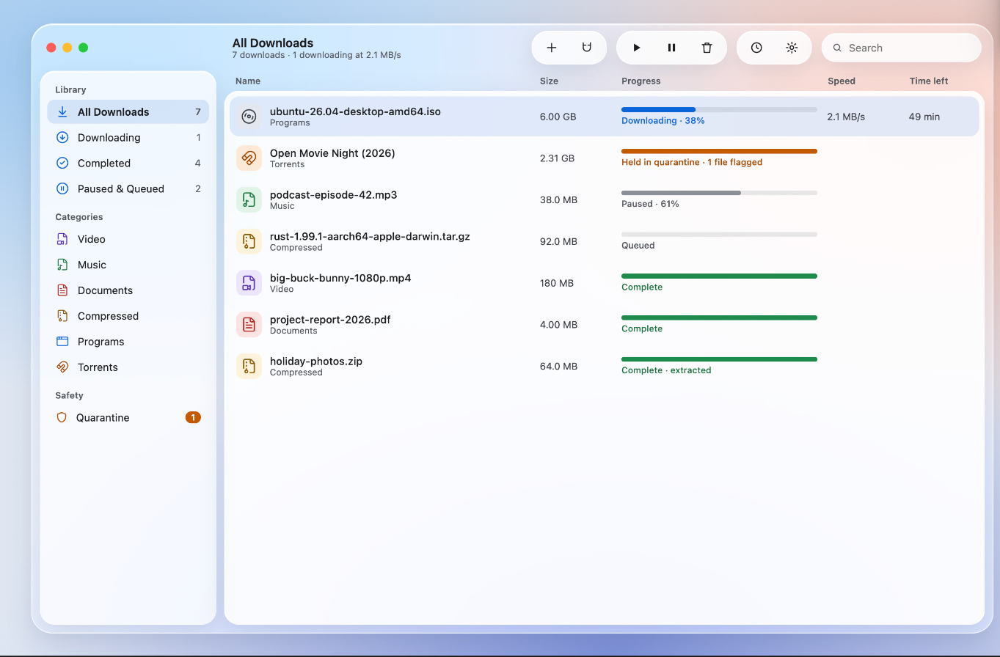
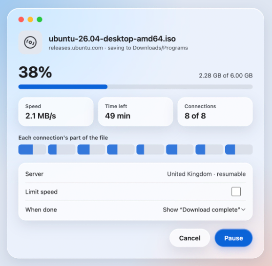
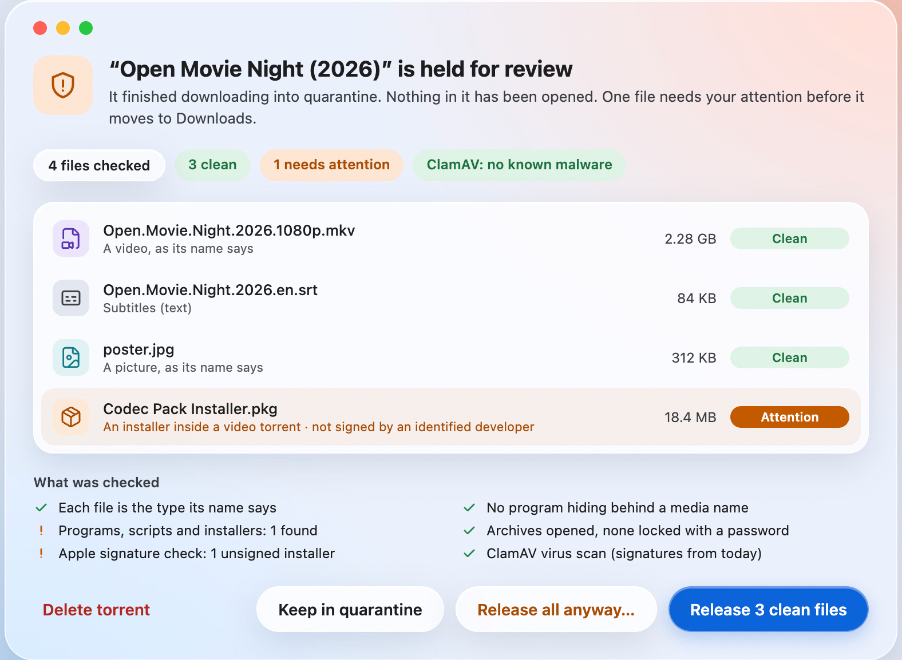

# Mister Download Manager for Mac (fork)

This fork ([MiteshYV/misterdownloadmanager](https://github.com/MiteshYV/misterdownloadmanager), branch `mac-native`) makes [Mister Download Manager](https://github.com/anefzaoui/misterdownloadmanager) feel at home on macOS and checks downloads before they reach your folders. Everything else is the original project's work.

## The new design: Liquid Glass

- **Liquid Glass** is the default theme on a Mac. The window sits on the system's own glass (macOS 26), with the older frosted blur on earlier versions.
- **A sidebar** holds the library (All Downloads, Downloading, Completed, Paused & Queued), the categories and **Quarantine**. Selection is a rounded band, without tree lines.
- **The toolbar** is grouped into capsule buttons (add, grab links · start, pause, delete · scheduler, options) with a search field.
- **File-type icons** come from [Lucide](https://lucide.dev) (ISC licence): 53 icons for videos, music, documents, archives, programs, torrents and more.
- **Progress** shows as a thin bar in each row, with the state in words under it: Downloading, Paused, Queued, Complete, Held in quarantine.
- **View → Theme** switches back to any other theme.

## Mac-native behaviour

- **The system's menu bar**: MDM's menus are in the Mac's own menu bar.
- **⌘,** opens Options, and **⌘W** closes the window in front.
- **Delete** and **⌘⌫** remove the selected downloads.
- **Trash**: files go to the Trash with Finder's own Trash, so Put Back works.
- **Applications check**: run from the disk image, or from a copy macOS moved aside (App Translocation), MDM asks to be moved to Applications instead of setting up a login item there.

## Quarantine: downloads checked before they reach your folder

A torrent downloads into a hidden folder beside its destination. When it finishes, every file is checked, and only then is it moved to your folder. Nothing in quarantine is opened or run.

A download is held for you to review when it holds:

- **a program, script, installer or app**, which a film or album has no reason to hold;
- **a disguised file**, one that isn't what its name says (a program named `.mp4`), or a name like `film.mp4.exe`;
- **a locked or loaded archive**: one locked with a password (a way past virus scanners), or one holding a program (ZIP, and RAR or 7z when 7-Zip is installed);
- **an unsigned app or installer**: on a Mac, one not signed by an identified developer (Apple's own checks);
- **anything ClamAV finds**.

The review window offers **Release** the clean files, **Release all anyway**, **Keep in quarantine** or **Delete**. A held download stays in the list as *Held in quarantine*, and opening it brings the review back.

**Options → Downloads → Virus checking settings** turns quarantine on or off for torrents (on by default), and on for every other download too.

### ClamAV, kept up to date

When ClamAV is installed (`brew install clamav`), it scans every download in quarantine too. MDM keeps its virus definitions current by itself: when they are more than a day old, it runs ClamAV's own `freshclam` in the background, at most every six hours. A fresh Homebrew install works without editing its sample config. The review window warns when the definitions are three days old or more.

## Updates

- **Help → Check for updates** reads this fork's releases, and **Update now** installs only a release whose checksum list this fork signed (key `7B2A74E0B7A377F67349D271A4023FEB261D137D`). A release signed by the original project is refused.
- **Version numbers** are the original's patch number times 100, plus this fork's release number. 0.5.201 is the first release based on the original's 0.5.2.
- **Crash reports** open an issue on this fork.

## Installing

1. From the [latest release](https://github.com/MiteshYV/misterdownloadmanager/releases/latest), download `MisterDownloadManager-<version>-macos-arm64-experimental.dmg` for Apple Silicon, or the `-macos-x86_64-` one for Intel.
2. Open it and drag **Mister Download Manager** onto the **Applications** folder beside it.
3. The app isn't notarised by Apple, so the first time macOS says it couldn't check it for malware. Click **Done**, then go to **System Settings → Privacy & Security**, find *"Mister Download Manager" was blocked* and click **Open Anyway**. You only do this once.
4. For virus scanning, install ClamAV too: `brew install clamav`.
